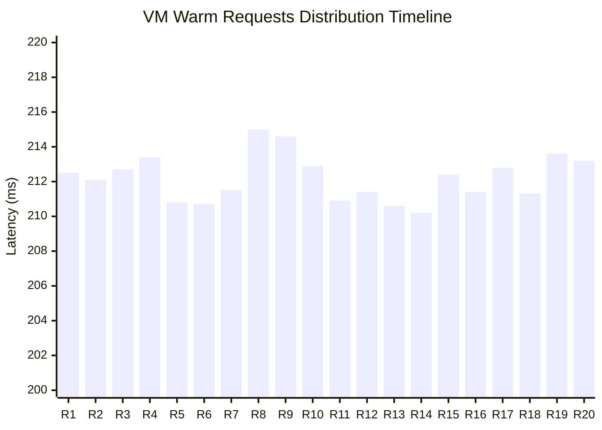

# Phase 1 — Comparison Report

## 1. Setup facts

**Your image size, in MB, from gcloud artifacts docker images list (number only, e.g. 142 ):**
<!--answer:size-->
49
<!--answer:size-->

**The custom VPC and subnet you created** (names only):
<!--answer:vpc-->
echo-net
<!--answer:vpc-->

<!--answer:subnet-->
echo-subnet
<!--answer:subnet-->

## 2. Measurements

Platform | Cold (ms) | Warm median (ms)
---|---|---
IaaS VM | <!--answer:vm_c-->241.7<!--answer:vm_c--> | <!--answer:vm_w-->212.2<!--answer:vm_w-->
Cloud Run | <!--answer:cr_c-->694.7<!--answer:cr_c--> | <!--answer:cr_w-->671.2<!--answer:cr_w-->
Cloud Function | <!--answer:cf_c-->1913.7<!--answer:cf_c--> | <!--answer:cf_w-->657.1<!--answer:cf_w-->

**Include your histogram or plot of the warm distribution below (an image, or the ASCII chart measure.py prints). This is read by a human, not the grader:**
<!--answer:plot-->
### Cloud Platform Latency: Side-by-Side Analysis

```mermaid
xychart-beta
    title "Phase 1: True Cloud Platform Latency Comparison (Grouped Side-by-Side)"
    x-axis ["Min", " ", "  ", "Med", "   ", "    ", "p95", "     ", "      ", "Max", "       ", "        "]
    y-axis "Response Time (ms)" 0 --> 800
    bar "Compute Engine VM" [210.2, 0, 0, 212.2, 0, 0, 214.6, 0, 0, 215.0, 0, 0]
    bar "Cloud Run" [0, 122.0, 0, 0, 671.2, 0, 0, 679.6, 0, 0, 687.6, 0]
    bar "Cloud Functions" [0, 0, 128.9, 0, 0, 657.1, 0, 0, 682.8, 0, 0, 685.4]
```

<!--answer:plot-->

## 3. Per-platform analysis

**Scaling behaviour.** **Imagine requests arriving one at a time, then ten at once, then a hundred. For each of the three platforms, answer concretely:**
<!--answer:scaling-->
The IaaS VM does not create anything automatically when a lot of traffic hits it; all requests are forced to wait in line to be processed by a single virtual machine. Its absolute limit is set by the low hardware power of the e2-micro size (1 vCPU, 1 GB RAM). Cloud Run automatically scales out by adding new container copies horizontally up to the strict cap of 3 instances that we set using the --max-instances flag. The Cloud Function scales out completely automatically on demand using Google's default serverless limits.
<!--answer:scaling-->

**Deployment effort.** **What did you have to build, configure and maintain to get each of the three running? (~100 words)**
<!--answer:effort-->
For the VM setup, I had to build a custom VPC network, subnets, and two separate firewall rules for ports 22 and 8080 from scratch. Then I had to SSH into the machine, download and install Docker using web scripts, fix IAM permissions so it could read from the registry, and manually run the container detached. For Cloud Run, the cloud handled the infrastructure, but I still had to build the Dockerfile and push the image to Artifact Registry first. For the Cloud Function, the effort was lowest because I just pointed the deploy command to my local code folder.
<!--answer:effort-->

## 4. Why do two of your three numbers look alike?

**With Cloud Run and your Function both deployed, run gcloud run services list and paste the complete output here, unedited:**
<!--answer:list-->
✔
SERVICE: echo
REGION: us-central1
URL: https://echo-161110259588.us-central1.run.app
LAST DEPLOYED BY: service-161110259588@gcf-admin-robot.iam.gserviceaccount.com
LAST DEPLOYED AT: 2026-10-29T22:41:12.285265Z

✔
SERVICE: echo-bot
REGION: us-central1
URL: https://echo-bot-161110259588.us-central1.run.app
LAST DEPLOYED BY: Bloorger@gmail.com
LAST DEPLOYED AT: 2026-10-29T22:10:28.254762Z
<!--answer:list-->

**Now explain what that output tells you about how your Function is actually being run, why its cold start resembles Cloud Run's so closely, and what — if anything — genuinely differs between the two deployment paths. (~120 words)**
<!--answer:architecture-->
This output shows that under the hood, Gen-2 Cloud Functions are actually just standard Cloud Run services. When you deploy the function, Google Cloud automatically packages your code and creates a hidden Cloud Run service named `echo` right alongside your `echo-bot` application. 

Because they run on the exact same infrastructure and use the same network routing, their warm speeds are almost identical (~657ms and ~671ms). 

The big difference is the cold start time. Cloud Run is much faster (694.7ms) because it pulls a container image that we already built and stored in Artifact Registry. The Cloud Function takes much longer (1913.7ms) because Google has to take your raw python files, build the container from scratch, install your requirements, and boot it up on demand.
<!--answer:architecture-->
